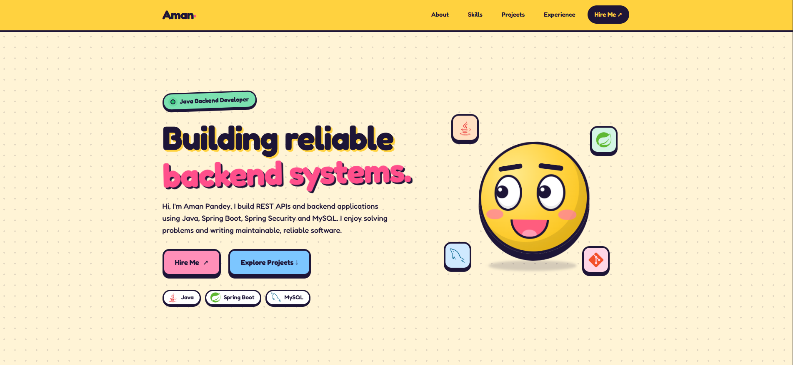
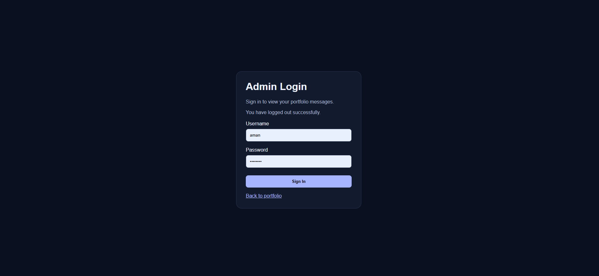
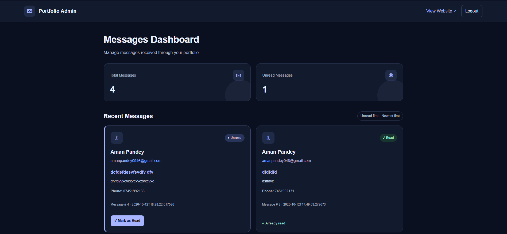

# Portfolio Website

A personal portfolio website built using **Java, Spring Boot, and MySQL**, featuring a contact form and a secure admin dashboard for managing messages.

## About the Project

This project demonstrates my skills in backend development, REST API development, database integration, authentication, and building web applications using Spring Boot.

Visitors can explore the portfolio and submit messages through the contact form. The admin dashboard allows the authorized administrator to view received messages and manage their read status.

## Features

- Personal portfolio homepage
- Contact form for visitor messages
- REST API integration
- MySQL database integration
- Admin login and protected dashboard
- Card-based message dashboard
- Read and unread message management
- Thymeleaf templates for server-side rendering
- Environment-based configuration for credentials
- Git and GitHub version control

## Screenshots

### 1. Portfolio Homepage



### 2. Admin Login



### 3. Admin Messages Dashboard



## Technology Stack

| Technology | Purpose |
|---|---|
| Java 21 | Backend programming |
| Spring Boot | Application framework |
| Spring MVC | Request handling |
| Spring Security | Authentication and access control |
| Spring Data JPA | Database operations |
| Hibernate | Object-relational mapping |
| MySQL | Relational database |
| Thymeleaf | Server-side HTML rendering |
| HTML and CSS | Frontend development |
| Maven | Dependency management and build |
| Git and GitHub | Version control |

## Project Structure

```text
portfolio/
├── src/
│   ├── main/
│   │   ├── java/com/aman/portfolio/
│   │   │   ├── config/
│   │   │   ├── controller/
│   │   │   ├── dto/
│   │   │   ├── entity/
│   │   │   ├── exception/
│   │   │   ├── repository/
│   │   │   ├── service/
│   │   │   └── PortfolioApplication.java
│   │   └── resources/
│   │       ├── static/
│   │       ├── templates/
│   │       ├── screenshots/
│   │       └── application.properties
│   └── test/
├── pom.xml
└── README.md
```

## Run the Project Locally

### Prerequisites

Install the following:

- Java 21
- MySQL Server
- Git

Maven can be run using the included Maven Wrapper.

### 1. Clone the repository

```bash
git clone https://github.com/amanpandey2025/portfolio.git
cd portfolio
```

### 2. Create the MySQL database

Open MySQL and execute:

```sql
CREATE DATABASE portfolio;
```

### 3. Configure environment variables

Configure the following variables in your IDE's Run Configuration or your operating system:

| Variable | Description |
|---|---|
| `DB_URL` | MySQL JDBC connection URL |
| `DB_USERNAME` | MySQL username |
| `DB_PASSWORD` | MySQL password |
| `ADMIN_USERNAME` | Admin login username |
| `ADMIN_PASSWORD` | Admin login password |

For local development, the database URL can be:

```text
jdbc:mysql://localhost:3306/portfolio
```

Use your own database credentials and a strong admin password. Do not commit actual passwords, API keys, or other secrets to GitHub.

### 4. Start the application

On Windows PowerShell, run:

```powershell
.\mvnw.cmd spring-boot:run
```

### 5. Open the website

When the application starts successfully, open:

- **Portfolio:** http://localhost:8080/
- **Admin Login:** http://localhost:8080/admin/login
- **Messages Dashboard:** http://localhost:8080/admin/messages

The application must be running locally for these localhost URLs to work.

## Security Considerations

- Keep database credentials outside source control.
- Use environment variables for sensitive configuration.
- Restrict the admin dashboard to authorized users.
- Use HTTPS and secure production configuration when deploying.
- Avoid exposing visitors' private messages and contact details in public screenshots.

## Future Improvements

- Deploy the application to a cloud hosting platform.
- Configure a managed cloud database.
- Add search, filtering, and pagination to the dashboard.
- Improve automated testing.
- Configure continuous integration and deployment (CI/CD).

## Author

**Aman Pandey**

- GitHub: [@amanpandey2025](https://github.com/amanpandey2025)
- Repository: [Portfolio Website](https://github.com/amanpandey2025/portfolio)

---

Built as a personal project to strengthen my skills in Java, Spring Boot, REST APIs, MySQL, and web application development.
